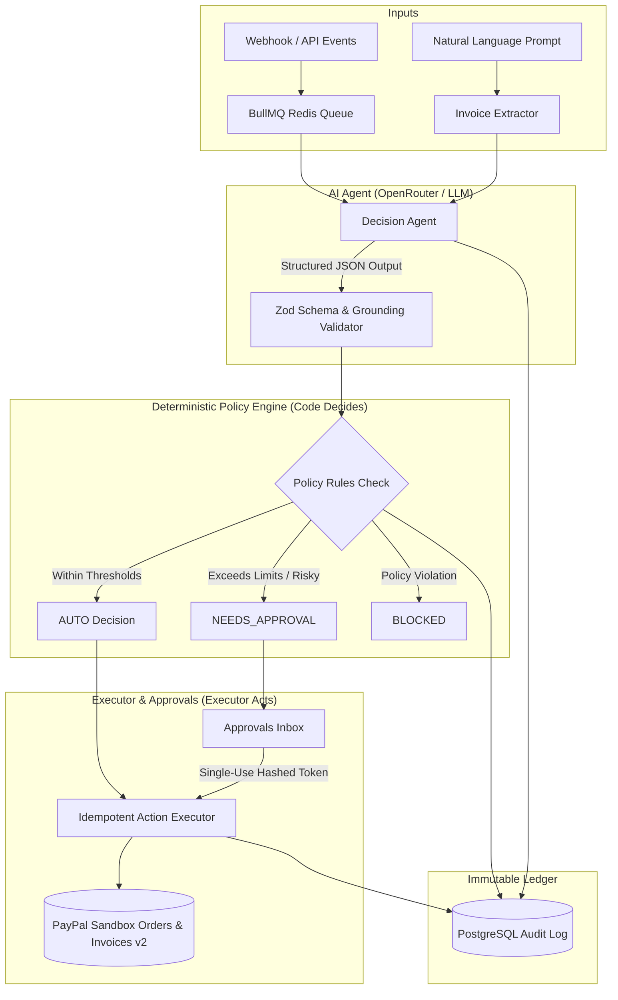
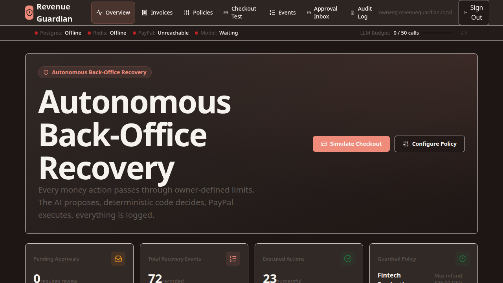
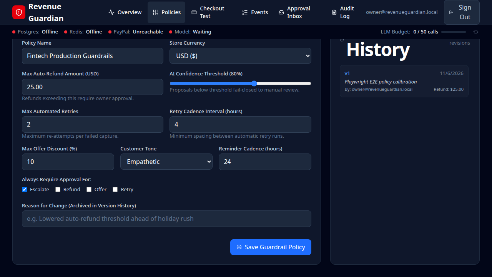
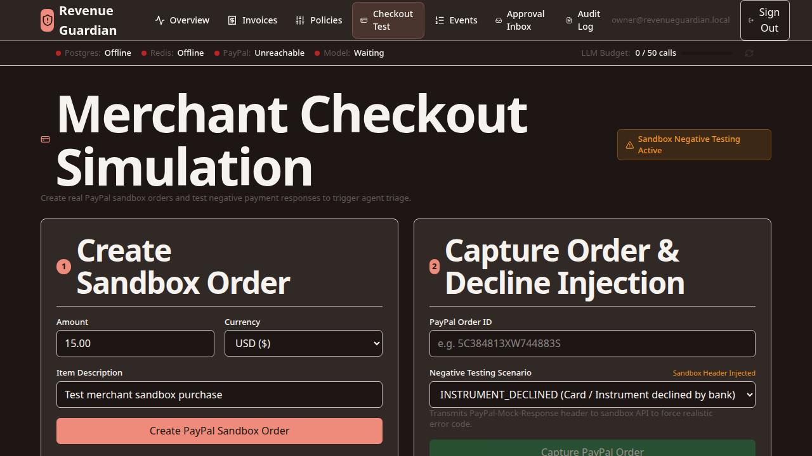
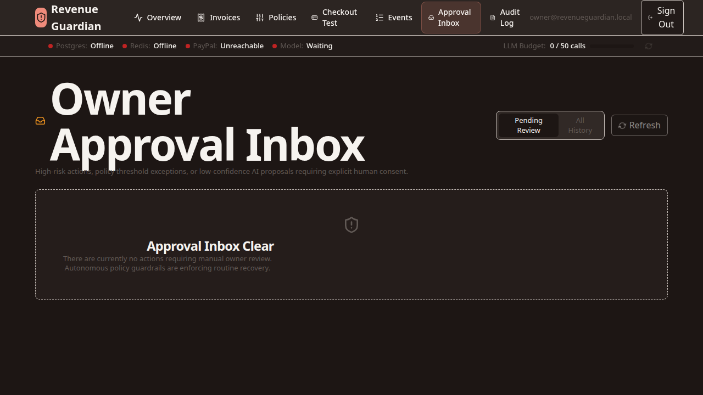
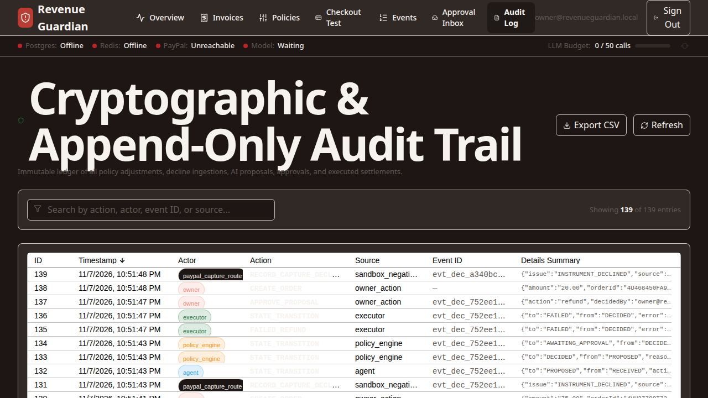
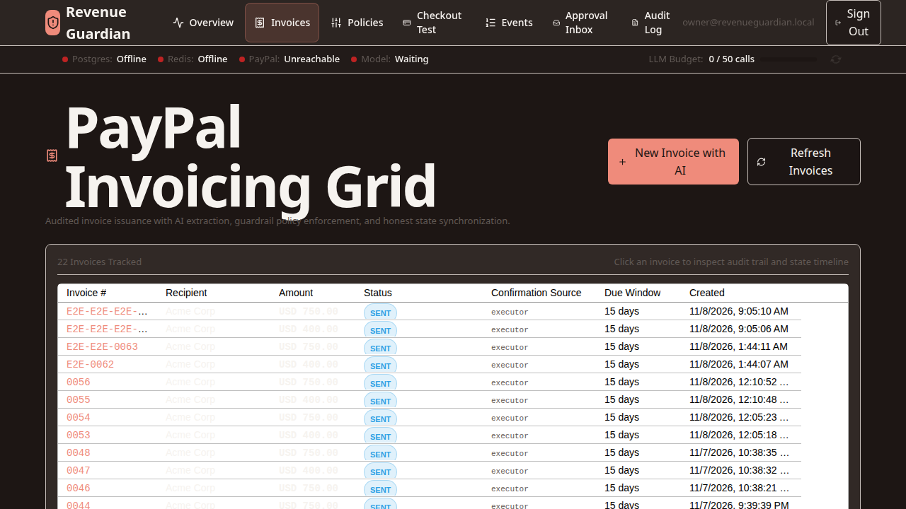

# Revenue Guardian

Autonomous payment recovery and back-office financial triage for PayPal merchants, built with deterministic code guardrails.

---

## 1. Problem & Audience

Small merchants and freelancers lose significant revenue every month to legitimate customer payment declines and delayed, manual invoicing workflows. Most automation tools either blindly retry failed transactions or require tedious manual intervention for routine customer interactions. Revenue Guardian gives merchants an autonomous financial triage system that safely recovers revenue, but because merchants will never hand an AI agent unlimited access to their money, every action is strictly bounded by hardcoded code guardrails and cryptographic approvals.

---

## 2. Architecture: "AI Proposes, Code Decides, Executor Acts"

Revenue Guardian strictly enforces separation between model reasoning and state mutation. The AI agent never touches PayPal API credentials, never executes balance transfers directly, and cannot override business policies.



### Core Principle
> **"AI proposes, code decides, executor acts."**  
> 1. **AI Proposes**: Models parse inputs and formulate structured proposals constrained strictly to grounded database fields.  
> 2. **Code Decides**: Deterministic policy rules in TypeScript evaluate amounts, retry counts, and customer risk.  
> 3. **Executor Acts**: Only the isolated `ActionExecutor` holds mutating PayPal SDK privileges, using SHA-256 idempotency keys.

---

## 3. What Is Built vs. What Is NOT Built

To respect your evaluation time, here is an honest inventory of implementation status:

### What Is Built
- **Orders v2 Capture & Recovery**: Real PayPal Sandbox checkout flow with automatic capture triage.
- **Negative Testing Simulation**: Uses PayPal's documented negative testing mock headers (`PayPal-Mock-Response: {"mock_application_codes": "INSTRUMENT_DECLINED"}`) to simulate realistic issuer declines. This is clearly labeled `sandbox_negative_testing` throughout the UI and audit logs.
- **Autonomous Recovery Loop**: Failed captures within merchant policy ceilings are retried cleanly without mock headers, recovering the transaction.
- **Invoicing v2 via Natural Language**: Model extracts line items, pricing, recipients, and due dates into valid PayPal Invoicing v2 draft payloads.
- **Cryptographic Approval System**: Over-limit actions generate single-use, payload-hash-bound approval tokens (`SHA-256`). Replaying an approved or rejected token fails with `409 Conflict`.
- **Dual Reconciler**: Automatic state reconciliation via real PayPal webhooks (when tunnel is configured) or an autonomous polling background worker (when running local-only without tunnels).
- **Audit Ledger**: Comprehensive audit trails in PostgreSQL displayed via real-time AG Grid interfaces.

### What Is NOT Built (Non-Goals / Future Work)
- **Recurring Subscriptions**: Subscription plans and automated billing agreements are not implemented.
- **Automated Dunning Reminders**: Periodic scheduled reminder emails for overdue invoices are not implemented.
- **Refund Dispute Triage**: Full dispute evidence submission (Disputes API) is not implemented; chargeback events are logged as read-only audit alerts.

---

## 4. Run-It-Yourself (10-Minute Setup)

Follow these tested, numbered steps to boot Revenue Guardian from a clean clone.

### Prerequisites
- [Docker](https://docs.docker.com/get-docker/) & Docker Compose (v2+)
- [Node.js 20+](https://nodejs.org/) & [pnpm](https://pnpm.io/)
- A **PayPal Developer Account** with Sandbox credentials ([developer.paypal.com](https://developer.paypal.com/dashboard/applications/sandbox))
- An **OpenRouter API Key** ([openrouter.ai](https://openrouter.ai/keys) — free tier works) or any OpenAI-compatible endpoint.

### Step 1: Clone the Repository
```bash
git clone https://github.com/your-username/revenue-guardian.git
cd revenue-guardian
```

### Step 2: Configure Environment Variables
Copy the template:
```bash
cp .env.example .env
```
Open `.env` and fill in the required variables:
- `PAYPAL_CLIENT_ID`: Your PayPal sandbox REST app client ID.
- `PAYPAL_CLIENT_SECRET`: Your PayPal sandbox REST app secret.
- `PAYPAL_BUSINESS_EMAIL`: The sandbox business merchant email.
- `OPENROUTER_API_KEY`: Your OpenRouter API key (or set `OPENROUTER_BASE_URL` to your OpenAI-compatible endpoint).
- `BETTER_AUTH_SECRET`: Any random 32+ character string (e.g. `openssl rand -hex 32`).
- `OWNER_EMAIL`: Merchant dashboard login email (e.g. `owner@revenueguardian.local`).
- `OWNER_PASSWORD`: Merchant dashboard login password (e.g. `OwnerSecurePass123!`).

*(Optional Live Model Calls)*: By default, `LLM_ALLOW_LIVE=false` guards your API budget. To enable live AI reasoning with OpenRouter, set:
```bash
LLM_ALLOW_LIVE=true
```

### Step 3: Boot Containers
```bash
docker compose up --build -d
```
This starts:
- `rg-postgres`: PostgreSQL 16 database on port `5433` (isolated port to avoid host conflict).
- `rg-redis`: Redis 7 instance on port `6379`.
- `rg-web`: Next.js web application on port `3000`.
- `rg-worker`: Background BullMQ event processor and polling reconciler.

Migrations and owner seeding run automatically on boot.

### Step 4: Verify Health & Readiness
Check service health:
```bash
curl -i http://localhost:3000/healthz
curl -i http://localhost:3000/readyz
```
Expected `/readyz` response when running locally without a tunnel:
```json
{
  "status": "READY",
  "checks": {
    "postgres": { "status": "UP" },
    "redis": { "status": "UP" },
    "paypalApi": { "status": "UP" },
    "llmBudget": { "status": "UP" },
    "paypalWebhook": {
      "status": "NOT_CONFIGURED",
      "message": "PAYPAL_WEBHOOK_ID is not configured in environment (polling reconciler active)."
    }
  }
}
```
*(Notice: The app returns `READY` HTTP 200. Webhooks are strictly optional; the polling reconciler handles state updates).*

### Optional Step 5: Webhook Configuration with Tunnel
If you wish to test real inbound PayPal webhook deliveries:
1. Start a public tunnel: `cloudflared tunnel --url http://localhost:3000`
2. Update `APP_URL=https://<your-subdomain>.trycloudflare.com` in `.env`
3. Run the sync script: `pnpm tsx scripts/sync-webhook.ts`
4. Copy the generated `PAYPAL_WEBHOOK_ID` into `.env` and restart: `docker compose restart web worker`

---

## 5. Judge's Demo Walkthrough (Click-by-Click)

Log in to the dashboard at `http://localhost:3000/login` with your `OWNER_EMAIL` and `OWNER_PASSWORD`.

### Scenario A: Declined Capture -> Autonomous Recovery
1. Navigate to **Policy Rules** (`/policies`). Confirm active policy allows Auto-Refund/Retry up to `$25.00 USD` with max 3 retries.
2. Go to the **Checkout Sandbox** (`/checkout`).
3. Select the **$25.00 Coffee Bean Subscription** package.
4. Click **Pay with PayPal Sandbox** and log in with your sandbox buyer credentials.
5. In the checkout flow, toggle **Simulate Instrument Declined** (`sandbox_negative_testing`). Click **Complete Purchase**.
6. The capture fails with `INSTRUMENT_DECLINED`.
7. Navigate to **Events** (`/events`). You will observe:
   - Event `PAYMENT.CAPTURE.DECLINED` captured.
   - AI Agent generates proposal: `action: "retry"`, `confidence: 0.90`.
   - Policy Engine evaluates: `AUTO` (under $25 limit).
   - Executor performs recovery capture on PayPal sandbox without mock headers.
   - Status updates honestly to `RECOVERED` (labeled `webhook-confirmed` or `polling-confirmed`).

### Scenario B: Natural Language Invoicing Under Limit (Autonomous Send)
1. Go to **Invoices** (`/invoices`).
2. In the AI prompt input, type:  
   `"Invoice techcorp@example.com $20 for 2 hours of web consulting, net 15 days"`
3. Click **Generate Draft**.
4. The model extracts line items and dates; policy engine detects amount ($20) $\le$ auto-invoice ceiling ($100).
5. The invoice is automatically sent via PayPal Invoicing v2.

### Scenario C: Over-Limit Invoice -> Human Approval Required
1. In the **Invoices** input, type:  
   `"Invoice enterprise@example.com $750 for quarterly server maintenance, due in 30 days"`
2. Click **Generate Draft**.
3. Policy engine detects $750 > $100 auto-send ceiling. Status becomes `NEEDS_APPROVAL`.
4. Go to **Approvals Inbox** (`/approvals`).
5. Review the cryptographic token, diff, and payload hash.
6. Click **Approve**. The executor performs the mutation, sends the invoice, and moves status to `SENT`.
7. View the permanent entry in **Audit Log** (`/audit`).

---

## 6. Tools Used & Architecture Stack

| Technology | Role in System |
|---|---|
| **Next.js 16 (App Router)** | Web interface, server actions, and protected API gateway |
| **PostgreSQL 16 & Drizzle ORM** | Relational state, policy versioning, and immutable audit ledger |
| **Redis 7 & BullMQ** | Asynchronous event queues, retries, and scheduled reconciliation sweeps |
| **OpenRouter / OpenAI API** | Multi-model reasoning (`nemotron-3-ultra-550b`, fallback chains) |
| **PayPal Orders v2 & Invoicing v2** | Core payment processing, order captures, and draft/send invoicing |
| **PayPal Webhooks API** | Cryptographic webhook signature verification (`v1/notifications/verify-webhook-signature`) |
| **AG Grid Community** | High-performance merchant grids for events, invoices, and audit trails |
| **Zod** | Strict runtime schema enforcement on all external inputs and LLM completions |
| **Better-Auth** | Secure single-owner session authentication and credential hashing |

---

## 7. Safety Design & Defenses

Revenue Guardian is built around defense-in-depth safety guarantees:

- **Fail-Closed Policy Engine**: If an event type is unrecognized, if policy rules are missing, or if model confidence falls below the configured threshold (default `0.85`), the system halts autonomous execution and routes to `NEEDS_APPROVAL` or `BLOCKED`.
- **Payload-Hash-Bound Single-Use Approvals**: Every approval token incorporates a SHA-256 digest of the exact action payload. Replay attempts or modified payloads immediately return `409 Conflict`.
- **Strict Mutating API Isolation**: Mutating PayPal calls are restricted to the `ActionExecutor` class (`tests/architecture-executor.test.ts` continuously verifies no route or worker directly mutates PayPal state).
- **Idempotency Keys**: All executor mutations transmit deterministic UUID idempotency keys (`req_<uuid>`), preventing duplicate captures or duplicate invoices during network retries.
- **Signature Verification**: Inbound PayPal webhook requests verify certificate chain and cryptographic signatures before payload parsing.
- **Simulated Event Segregation**: Deliveries generated by simulators or tests are tagged `simulated` and prevented from triggering real financial mutations.
- **Budget Protection Gate (`LLM_ALLOW_LIVE`)**: Accidental API consumption is prevented by a hard runtime gate. Live calls throw immediately unless explicitly permitted.

### Running Tests
Execute the comprehensive test suite (Vitest):
```bash
pnpm test
```
Execute isolated end-to-end browser tests (Playwright):
```bash
pnpm exec playwright test
```

### Known Limitations
1. **OpenRouter Free Tier**: Free model quotas are subject to upstream provider rate limits.
2. **PayPal Sandbox Latency**: Sandbox capture and webhook emission can experience 5–20 second propagation delays. The polling reconciler safely handles eventual consistency.
3. **Ephemeral Tunnels**: Quick Cloudflare tunnel domains change on restart; run `pnpm tsx scripts/sync-webhook.ts` if restarting tunnels.

---

## 8. Interface Gallery

All screenshots are stored in `docs/screenshots/`:

| Screen | Description |
|---|---|
| **Dashboard** | Real-time recovery metrics, active policies, and system status |
|  | |
| **Policy Configuration** | Merchant-controlled thresholds, auto-refund limits, and retry rules |
|  | |
| **Sandbox Checkout** | Test storefront with negative testing controls |
|  | |
| **Approvals Inbox** | Cryptographically bound approval triage for high-value actions |
|  | |
| **Audit Ledger** | Immutable AG Grid tracking every proposal, decision, and mutation |
|  | |
| **Invoicing Triage** | Natural-language draft creation with line-item extraction |
|  | |

---

## 9. License

This project is licensed under the [MIT License](LICENSE).  
Copyright (c) 2026 lalith.
